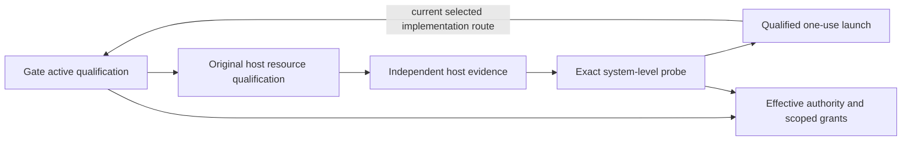

# Qualification Bootstrap Dependency-Cycle Resolution — Package 88

RESULT = PARTIAL. The current strategy's cycle is confirmed and a graph-level acyclic prospective path is defined. No independently qualified bootstrap executor or execution trust root is established, no implementation occurred, and no approval option or grant was issued.

## Exact cycle and policy boundary

Edges point from a dependent to its required prerequisite. The minimal strongly connected component has five nodes: gate active qualification, host resource qualification, independent host evidence, the system-level probe, and qualified once-launch. Contracting the explicit evidence-production link yields the four operational prerequisites.



The final edge is a strategy choice, not a requirement that the complete H77 gate be the only possible one-use implementation. The at-most-one attempt, irreversible consumption, no-retry and exact-command obligations remain mandatory. The separate DRAFT→REVIEWED→APPROVED→EFFECTIVE authority lifecycle is acyclic and not classified as a defect. System pids metadata would establish only one host-control prerequisite, not all resource/network/filesystem/cumulative-write guarantees.

## Candidate comparison and minimum route

| Candidate | Existing evidence | Missing qualification | Prospective consequence |
|---|---|---|---|
| A: existing host facilities | Systemd property documentation, OS publication primitives, retained documentary publisher evidence | Applicable durable grant-to-launch executor, actual stable store/host permissions, duplicate/crash proof | Reuse first if an actual independently qualified executor is nominated. Loaded service-name uniqueness and flock alone are insufficient. |
| B: minimal standalone coordinator | Reusable publication/barrier/reread protocols and exact Package86/87 scope | Separately approved smaller bootstrap trust contract, basic store/operator/observer qualification, bounded construction and inert tests | Smallest currently specified fallback: one command-specific coordinator plus one test file. No general framework or original gate modification. |
| C: external qualified context | No nominated available qualified provider | Actual host/launcher certificate, administrator/resource permission and exact transfer/scope evidence | Do not assume a second Ubuntu machine/VM is available or qualified. |

The preferred prospective fallback is B, with A-first reuse if actual qualified evidence arrives. This preference is based on defined scope and known missing inputs, not invented effort estimates. The design reuses narrow independently evidenced OS publication protocols; it does not import or call an issuance script, native save/restore/capture, or the unqualified original gate.

The alternative replaces `QUALIFIED_ONE_USE_LAUNCH → GATE_ACTIVE_QUALIFICATION` with `QUALIFIED_ONE_USE_LAUNCH → BOOTSTRAP_MECHANISM`. Bootstrap then depends on an independently approved basic POSIX/trusted-fixed-program/store/observer baseline and exact scoped authority. It must not depend on the system pids result or full H77 host contract it is enabling. Independent reachability reconstruction finds no SCC in that prospective graph.

This requires a separate prospective governance approval of the narrower bootstrap assurance/test contract. It is not silently substituted for Package70/80's full kernel process-tree/confinement requirements. Trusted fixed inert participants are a different, explicitly bounded assurance scope; no hostile/uncontrolled-code containment claim is made. The original one-use policy, approved H77 subject and frozen A15 acceptance remain unchanged. No owner promise alone substitutes for a qualified mechanism.

## Smallest missing prerequisites and authority

Two new source paths are proposed only: `adapter/qualification_bootstrap/systemd_pids_once.py` and `adapter/tests/test_systemd_pids_bootstrap.py`. Package80 does not authorize them or expansion to a new command family. The draft permits only bounded construction and independently supervised inert qualification after separate approval; it excludes actual system-level service/probe execution. It contains the exact unchanged Package86 target as a non-executable binding, not a new probe permission.

A stable permanent once-key, exclusive reservation, complete write, file/directory barriers, independent reread, current authority epoch and first-winner-only nonexportable handoff are required. Partial/duplicate/unknown outcomes remain consumed. Inert qualification must exercise these properties without using actual H77 grants/checkpoints/commands or a real service. Actual basic environment/store/observer permissions, exact fixtures/oracles/test invocations and the new trust contract remain unbound. No whole original gate/host qualification is reintroduced as their prerequisite.

The technical independent trust root is therefore not yet found/qualified; the existing governance root remains effective and the host administrator remains owner-attested. The exact two-file construction/inert-test subject is an incomplete draft with no selectable dossier. Next: adopt and independently ground the small bootstrap baseline, qualify an existing applicable executor if available, otherwise complete the minimal coordinator authority subject. After its qualification, return to Package87, separately authorize/issue the exact probe grant, obtain host controls and return to the original H77 qualification path. Cumulative-write and other original host controls remain separate.

## LL-11 and verification

The existing register's121-event chain and head were authenticated, and all10 prior lessons reviewed for an exact duplicate. LL-01/02/03/04/06/10 are related but do not record this coupled bootstrap SCC and independent trust-root requirement. LL-11 was appended using the exact existing LESSON_RECORDED event envelope and hash rules. All prior events remain equal; the Markdown's prior bytes remain a prefix. The old full-file snapshots are retained so historical whole-register byte pins still have immutable version evidence.

LL-11 records the supplied observation/failure mode, candidate SCC/bootstrap strategy capability and knowledge fields, counterevidence, confidence and unvalidated causal status. No Planner runtime capability or measured efficiency improvement is claimed. Register head: `885fd0eaceb15847201dfd058217682741fb43c255298713ccbc1e7251eec791`. Lesson content identity: `c2e49d3d786e303be8a331c3675e66123b94dbdd1c9d80fe6219fe2a2a1f6183`.

Primary Tarjan SCC construction is independently checked using reachability equivalence. Four fresh metadata readers under seeds0,1,7,101 agree on graph, candidates, readiness and lesson identities;16/16 static negatives reject false qualification, unsafe one-use behavior, unsupported trust, scope expansion and recurrence of the bootstrap cycle. No probe, service, gate test or actual A15 operation ran. Existing charter lifecycle, normative mandate and construction grant still verify after the authorized register append. Only the two lessons-register files changed among prior files; all source/evidence records and stopped journal remain unchanged. No A14 rerun, operand promotion, native authority issuance or production effect occurred.

## Required report

```text
WORK_PACKAGE = E2-P05-D01-H77-02-QUALIFICATION-BOOTSTRAP-88
AUTHORITY_DECISION_READY = NO
BOOTSTRAP_QUALIFIED = NO
DECISION_OPTIONS = []
DEPENDENCY_CYCLE_CONFIRMED = YES
INDEPENDENT_TRUST_ROOT_FOUND = NO
RESULT = PARTIAL
MINIMAL_CYCLIC_COMPONENT = ['GATE_ACTIVE_QUALIFICATION', 'HOST_RESOURCE_ENFORCEMENT_QUALIFICATION', 'INDEPENDENT_EVIDENCE', 'QUALIFIED_ONE_USE_LAUNCH', 'SYSTEM_LEVEL_PROBE']
BOOTSTRAP_CANDIDATES_EVALUATED = 3
PREFERRED_BOOTSTRAP_STRATEGY = B_MINIMAL_COMMAND_SPECIFIC_COORDINATOR_REUSING_EVIDENCED_PRIMITIVES
REVISED_STRATEGY_ACYCLIC = YES_DESIGN_ONLY
LESSONS_REGISTER_VERIFIED = YES
LESSON_APPENDED = YES
LESSON_ID = LL-11
FOUR_SEED_DETERMINISM = PASS:0,1,7,101
NEGATIVE_SUITE = 16/16 PASS (static)
TOTAL_REFERENCES = 161
TOTAL_RESOLVED = 109
TOTAL_UNRESOLVED = 52
SYSTEM_LEVEL_PROBES_EXECUTED = 0
SYNTHETIC_TESTS_EXECUTED = 0
H77_02_PROBE_EXECUTED = NO
A15_EXECUTED = NO
NEXT_CRITICAL_BLOCKER = Adopt an independently grounded smaller bootstrap trust/baseline and complete the bounded coordinator construction/inert-test subject; supply actual basic store/operator/observer qualification. No full H77 host-control result is required as its prerequisite.
PRODUCTION_EFFECT = NO
GATE_SOURCE_FILES_MODIFIED = 0
ADAPTER_SOURCE_FILES_MODIFIED = 0
STOPPED_CAMPAIGN_MODIFIED = NO
A15_EXECUTION_AUTHORITY_ISSUED = NO
A15_CAPTURE_AUTHORITY_ISSUED = NO
BASELINE_AMENDED = NO
V3_SELECTED = YES
FROZEN_OBLIGATIONS = 128
CONCRETE_DISPATCH_JOBS = 220
E1_ARTIFACTS_MODIFIED = 0
git_diff_check = PASS
```

Evidence: [typed graph](dependency-cycle-graph.json), [SCC](minimal-cyclic-component.json), [candidates](bootstrap-candidate-inventory.json), [comparison](trust-and-authority-comparison.json), [acyclic strategy](minimum-cycle-breaking-strategy.json), [minimal design](minimal-bootstrap-design.json), [unissued draft subject](proposed-bootstrap-authority-subject.json), [remaining gap](remaining-gap-dossier.json), [LL-11 event](ll11-appended-event.json), [lesson validation](lessons-register-independent-verification.json), [independent reconstruction](independent-verification.json), [four seeds](four-seed-reconstruction.json), [negatives](negative-controls.json), [preservation](preservation-audit.json).
